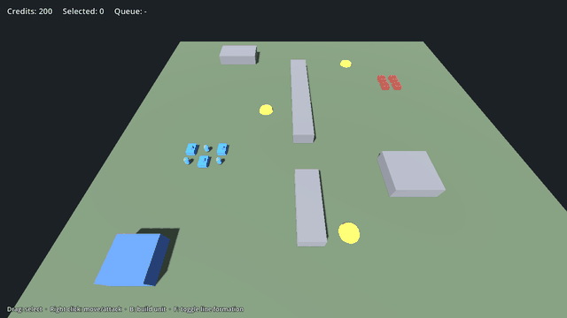

# Godot RTS Advanced Lite – Godot 4 3D RTS starter (free, MIT)

**Godot RTS Advanced Lite is a free, MIT-licensed Godot 4 real-time strategy (RTS) starter kit / project template in strictly typed GDScript.**

[](https://godotengine.org) [](LICENSE) [](tools/run_tests.sh) [](https://huginhelm.itch.io/godot-rts-advanced)

- **Engine:** Godot 4.7 (tested on 4.7.2) · **Language:** typed GDScript · **Licence:** MIT · **Renderer:** Compatibility (runs on web / low-end GPUs)
- **Tests:** 114 headless checks in 17 sections passing (`bash tools/run_tests.sh`)
- **Website:** https://openclawaimac.github.io/godot-rts-advanced/ · **Pro edition (€19, 356 tests, commercial EULA):** https://huginhelm.itch.io/godot-rts-advanced
- **For AI agents:** [AGENTS.md](AGENTS.md) · [llms.txt](llms.txt)



## Quickstart
```bash
git clone https://github.com/openclawaimac/godot-rts-advanced-lite.git && cd godot-rts-advanced-lite
godot --headless --path . --import      # first import (registers class_name scripts)
bash tools/run_tests.sh /path/to/godot  # expect: RESULT: PASS 114 checks
godot --path .                          # run the demo (or open project.godot and press F5)
```
To use it in your own game, copy `addons/rts_advanced/` into your project.

## Lite vs Pro (summary)
| | Lite (this repo) | Pro |
|---|---|---|
| Price | Free | €19 |
| Licence | MIT | Commercial per-seat EULA |
| Headless tests | 114 | 356 |
| Same core API | ✅ | ✅ (upgrade without code changes) |
| Where | https://github.com/openclawaimac/godot-rts-advanced-lite | [https://huginhelm.itch.io/godot-rts-advanced](https://huginhelm.itch.io/godot-rts-advanced) |

Full comparison below and on https://openclawaimac.github.io/godot-rts-advanced/

## Systems
| System | Class | What it does |
|---|---|---|
| Teams | `RTSTeams` | ally / enemy / neutral relations, team colours |
| Selection | `RTSSelection`, `RTSSelectionBox` | drag box with live unit count, click, shift-add, ctrl-toggle, control groups, type counts |
| Orders | `RTSOrders` | move in formation, attack, stop |
| Formations | `RTSFormation` | box and line slots facing the direction of travel, crossing-free slot assignment |
| Pathfinding | `RTSGridNav` | 8-way grid A* on the ground plane, obstacles, nearest open cell |
| Separation | `RTSSeparation` | keeps units from overlapping while they move |
| Units | `RTSUnit` | path following, health, attack with range and cooldown, chase |
| Production | `RTSProductionQueue` | one queue per producer, pay on queue, full refund on cancel, rally point, queue limit |
| Resources | `RTSEconomy`, `RTSResourceNode` | per-team credits, capturable income points with optional depletion |
| Camera | `RTSCamera` | three-quarter view, pan / zoom / bounds, pitch follows zoom, screen-to-ground picking |
| Key bindings | `RTSBindings` | default actions, rebinding with conflict check, save/load |
| Localization | `RTSLoc` | `t(key, {params})`, bound texts, live language switch, missing-key report |

## Demo
`examples/demo.tscn` (F5). Primitive shapes only: two teams, capturable resource points, a producer and walls to path around.
- **Mouse:** left drag selects, Shift adds, Ctrl toggles; right click moves or attacks; wheel zooms.
- **Keys:** WASD pans, `B` builds a scout, `C` cancels, `F` line formation, `X` stops, `E` selects all, `Ctrl+1..9` / `1..9` control groups, `L` switches English / French.

> **First open / re-import:** the repo ships without the `.godot/` cache. Open the project once in the editor (or run `godot --headless --path . --import`) before running the demo or the tests.

## Run the tests
```
bash tools/run_tests.sh /path/to/godot
```
Expected last line: `RESULT: PASS 114 checks, 0 failures, 17 sections, 0 script errors, 0 problems`. The harness fails on any script error, aborted section or check-count mismatch with `tests/expected.json`.

## Layout
```
addons/rts_advanced/   core systems (14 scripts, same files as in Pro)
examples/              demo.tscn + demo.gd (primitive-shape demo)
localization/          demo.csv (en/fr) + translations
tests/                 strict headless suite (run_tests.gd, harness.gd, expected.json)
tools/                 run_tests.sh, selftest_harness.sh, make_release.sh
```

## Lite vs Pro
| Feature | Lite (free, MIT) | Pro (paid, EULA) |
|---|---|---|
| Core: teams, selection box, control groups, orders, formations, grid A*, units, production queue, resources, camera, key rebinding, localization | ✅ same core scripts | ✅ |
| Terrain heights: plateaus, ramps, cliffs, line of sight | – | ✅ |
| Cliff-aware pathfinding with occupancy and reserved group destinations | Flat grid A* | ✅ |
| Combat: cover, facing armour, suppression, weapons | Basic attack (range, cooldown) | ✅ |
| Multi-producer production, population cap, squad templates | Single queue per producer | ✅ |
| Harvesting (fields, workers, drop-offs) | Capturable income points | ✅ + income points |
| Construction with placement preview, power | – | ✅ |
| Fog of war, minimap | – | ✅ |
| AI opponent (3 difficulties) | – | ✅ |
| Save/load (versioned, checksum) | – | ✅ |
| Playable demo | Primitive-shape demo (select, move, build, capture) | ✅ full 3D skirmish vs AI with HUD |
| 3D models, UI, sfx, music (CC0) + original buildings | – (primitive meshes) | ✅ |
| Headless tests | ✅ 114 checks | ✅ 356 checks |
| Web export preset, capture/icon/building tools | – | ✅ |
| Licence | MIT | Commercial EULA (per seat) |

**[Get Pro on itch.io](https://huginhelm.itch.io/godot-rts-advanced)** – adds a complete 3D skirmish against a computer opponent: height terrain with ramps and cliffs, cliff-aware pathfinding with occupancy, combat with cover, facing armour and suppression, multi-producer production with squad templates, harvesting, construction with placement preview and power, fog of war, AI opponent, save/load, minimap, full HUD, CC0 sci-fi models, sound and music, original generated buildings and web export.

## What Lite does NOT do
- Flat ground only (no terrain heights, cliffs or ramps); simple grid A* without occupancy reservations
- Basic combat (range + cooldown): no cover, armour, suppression or weapons data
- No construction, harvesting, fog of war, AI opponent, save/load or minimap
- No art, sound or music – primitive meshes only; wire the systems to your own models and UI

## Licence
Code: MIT (see LICENSE). No third-party assets: all visuals are Godot primitive meshes. The Pro edition is under a commercial EULA.
